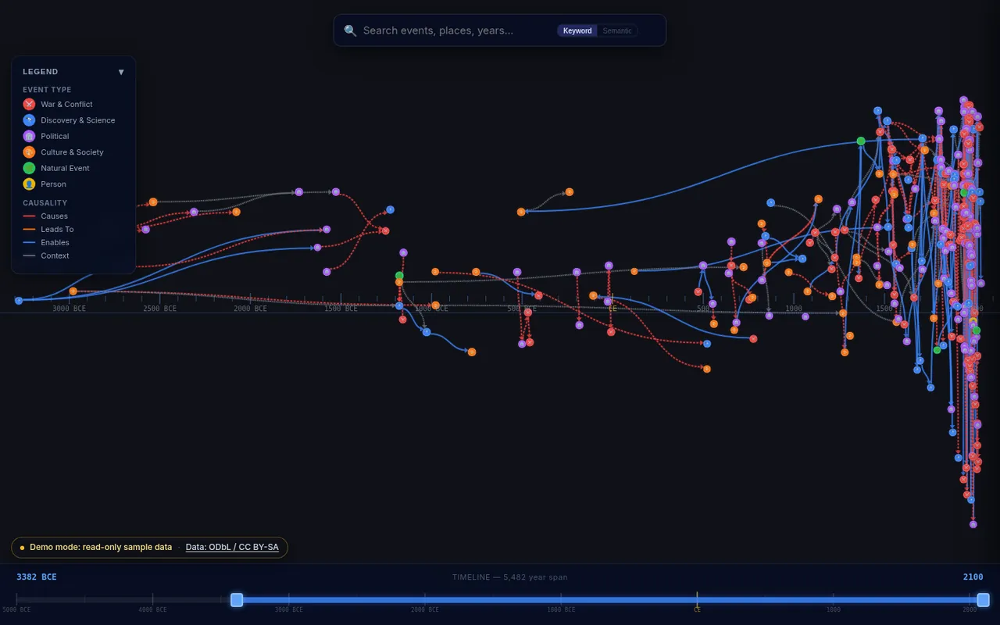
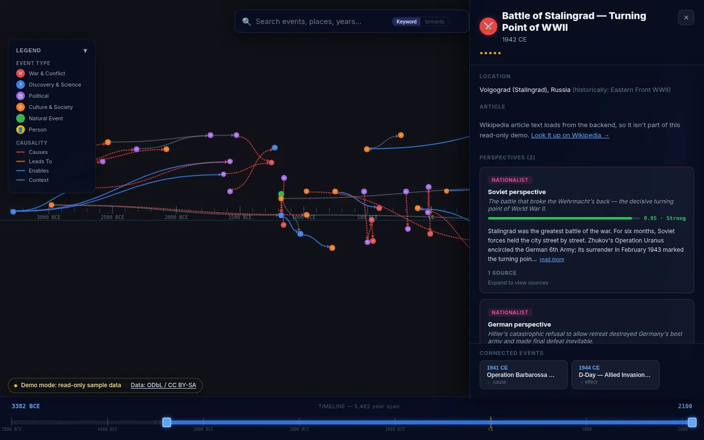
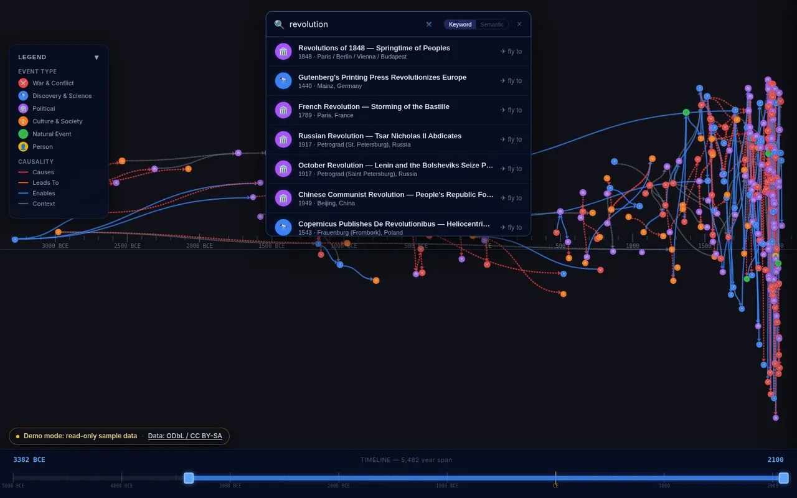
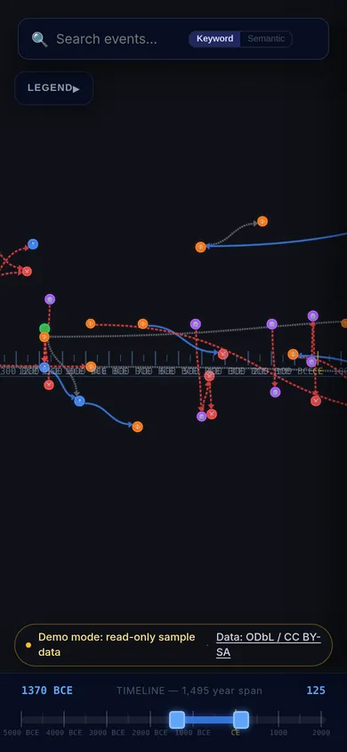

# Chronicle


**Open-source immutable historical timeline.**  
An infinite canvas where history is explored spatially — time on the X axis, geography on the Y axis, causality as visual connections.

---

## What Makes This Different

- **Multiple perspectives per event** — ranked by evidence quality, not popularity
- **Causality as a first-class visual element** — trace WWI → Versailles → WWII visually
- **Immutable edit log** — every change is recorded forever; nothing is deleted, only superseded
- **Evidence-based, not vote-based** — perspectives ranked by source quality (primary sources, peer review, diversity)

---

## Quick Start

### Prerequisites
- Docker + Docker Compose
- Python 3.11+

### 1. Start the database and search engine

```bash
docker-compose up -d
```

Wait for PostgreSQL and Meilisearch to be healthy:

```bash
docker-compose ps
```

### 2. Set up the backend

```bash
cd backend
python -m venv .venv
source .venv/bin/activate   # Windows: .venv\Scripts\activate
pip install -r requirements.txt
```

### 3. Configure environment

```bash
cp .env.example .env
# Edit .env if needed — defaults match docker-compose
```

### 4. Run database migrations

```bash
alembic upgrade head
```

### 5. Seed 500 historical events

```bash
python scripts/seed_events.py
```

This populates ~500 real historical events spanning 3000 BCE–2000 CE, including:
- Rich WWI→WWII causality chains
- Multiple perspectives per event
- Source citations

### 6. Start the API server

```bash
uvicorn app.main:app --reload
```

API is now live at **http://localhost:8000**  
OpenAPI docs: **http://localhost:8000/docs**

> **Note:** The docker-compose maps PostgreSQL to **port 5433** (not 5432) to avoid conflicts
> with local PostgreSQL installations. The `.env` defaults are pre-configured for this.
> If port 5433 is free and you have no local PostgreSQL, you can change it to 5432.

---

## Static demo mode (no backend)

The frontend can also run as a **read-only static demo**. It uses a JSON snapshot of the seed data
in place of the API, so it can be hosted on any free static host with no database, Meilisearch or Python.

| Demo | Live app |
|---|---|
|  |  |
|  |  |

**What the demo includes:** about 300 of the highest-importance seed events from 3300 BCE onward, their
causality links and perspectives, the network canvas, timeline scrubber, legend, keyword search,
event detail panel and bookmarks/share links.

**What it leaves out:** everything that needs the backend. That means Wikipedia article text (the
panel links to Wikipedia instead), semantic search, "On This Day", event submission and the admin
review queue. A banner reads "Demo mode: read-only sample data". It's a sample, not the full dataset.

```bash
cd frontend
npm run dev:demo       # dev server in demo mode
npm run build:demo     # production build to frontend/dist (includes dist/demo/snapshot.json)
npm run preview:demo   # serve the built demo locally
```

The normal `npm run build` is unchanged. Demo code is tree-shaken out and `dist/demo/` is removed.

### Regenerating the snapshot

The snapshot is built from the files in `seeds/` (no database needed):

```bash
python3 scripts/export_demo_snapshot.py               # defaults: --limit 300 --min-year -5000
python3 scripts/export_demo_snapshot.py --limit 500 --min-year -3000
```

It writes `frontend/public/demo/snapshot.json`, which keeps only links where both ends are in the
sample, merges obvious duplicate seed events (set `CHRONICLE_EXPORT_VERBOSE=1` to list merges)
and embeds the data license.

### Hosting the demo for free

Use any static host with an SPA fallback to `index.html`:

- **Vercel:** `vercel.demo.json` holds the demo config (build `npm run build:demo`, output
  `frontend/dist`, SPA rewrites, security headers). Use it with `vercel --local-config vercel.demo.json`,
  or copy its build/output settings into a separate Vercel project. The root `vercel.json` stays
  the full-app config.
- **Cloudflare Pages / Netlify:** root directory `frontend`, build command `npm run build:demo`,
  output `dist`, and a SPA fallback (`/* /index.html 200` in `public/_redirects` on Netlify; Pages
  serves `index.html` for unknown routes by default).

Hosting the demo publishes the sample data and the UI. The snapshot carries ODbL / CC BY-SA
attribution (see `LICENSE-DATA.md`), and so does the banner.

---

## API Endpoints

| Method | Endpoint | Description |
|--------|----------|-------------|
| GET | `/api/health` | Health check |
| GET | `/api/canvas/tiles` | Spatial+temporal tile query for canvas |
| GET | `/api/events/{slug}` | Full event with perspectives |
| GET | `/api/events/{slug}/connections` | Causality connections |
| GET | `/api/search?q=query` | Full-text search |

### Canvas tile query example

```
GET /api/canvas/tiles?zoom=5&year_min=1914&year_max=1945&bbox=-180,-90,180,90
```

### Search example

```
GET /api/search?q=World+War&limit=10
```

---

## Architecture

```
backend/
├── app/
│   ├── main.py          # FastAPI entry point
│   ├── models.py        # SQLAlchemy ORM models
│   ├── schemas.py       # Pydantic v2 response schemas
│   ├── database.py      # Async SQLAlchemy engine + session
│   └── routers/
│       ├── canvas.py    # /api/canvas/tiles
│       ├── events.py    # /api/events/{slug}
│       └── search.py    # /api/search
├── alembic/             # Database migrations
├── scripts/
│   └── seed_events.py   # 500-event seed script
├── requirements.txt
└── .env.example
```

**Database:** PostgreSQL 16 + PostGIS (geo) + pgvector (semantic search)  
**Search:** Meilisearch (full-text, instant)  
**API:** FastAPI + SQLAlchemy 2.x async + Pydantic v2

---

## Data Model

- **events** — core historical events with geo, date, importance
- **perspectives** — multiple accounts per event (e.g., Allied vs. German view of WWI)
- **sources** — bibliographic citations supporting each perspective
- **causality_links** — directed graph: cause → effect
- **people** — historical figures linked to events
- **edit_log** — immutable append-only audit trail

---

## Security

Please report vulnerabilities privately; see [SECURITY.md](./SECURITY.md). Admin endpoints
require an `ADMIN_KEY` environment variable (24+ random characters) and are disabled without it.

## License

- Code: [MIT](./LICENSE) © 2026 Ryan McGuiness
- Data (events, perspectives, sources): [ODbL 1.0](https://opendatacommons.org/licenses/odbl/1-0/)
- Content text (narratives): [CC BY-SA 4.0](https://creativecommons.org/licenses/by-sa/4.0/)
- Wikipedia text shown in the app: CC BY-SA 4.0, © Wikipedia contributors

Details in [LICENSE-DATA.md](./LICENSE-DATA.md).

---

*Built as a proof of concept.*
